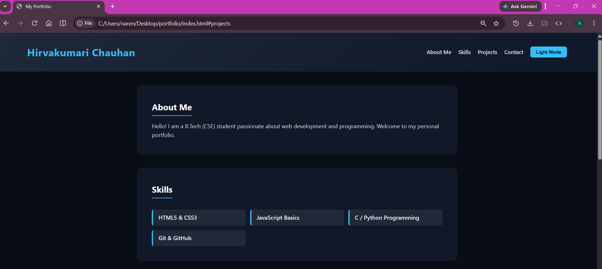
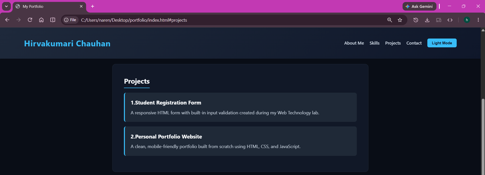
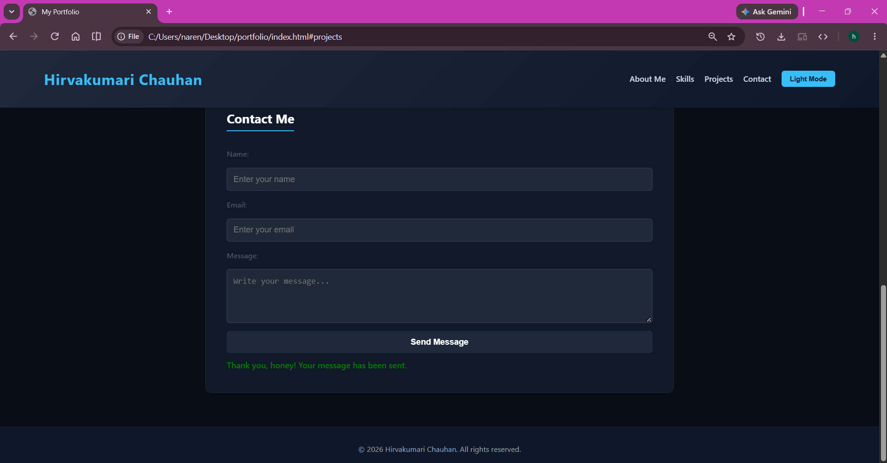
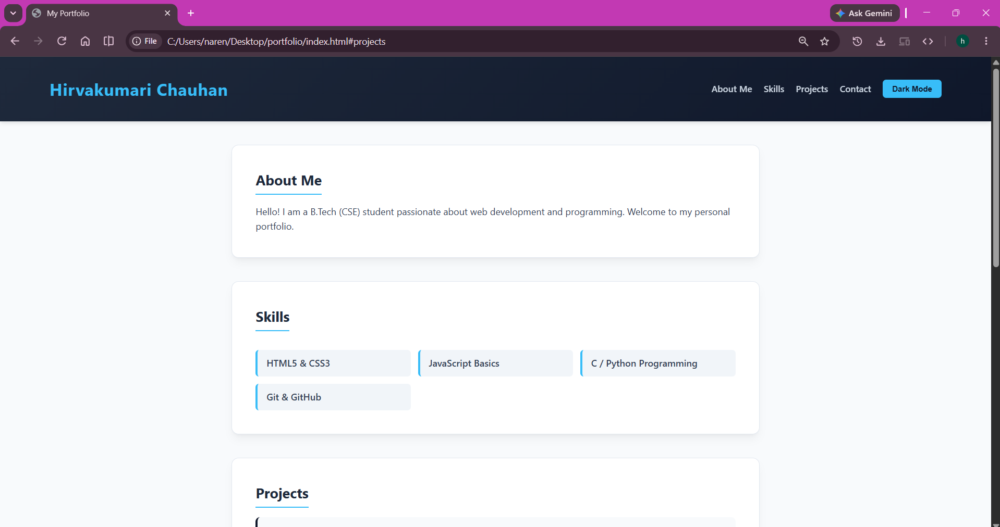
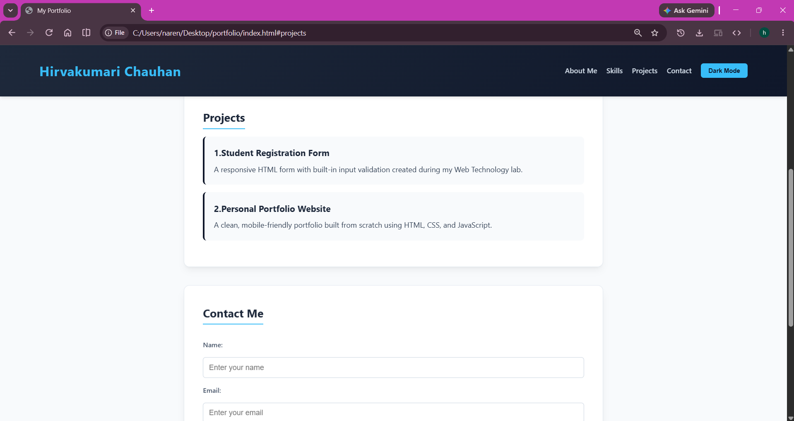
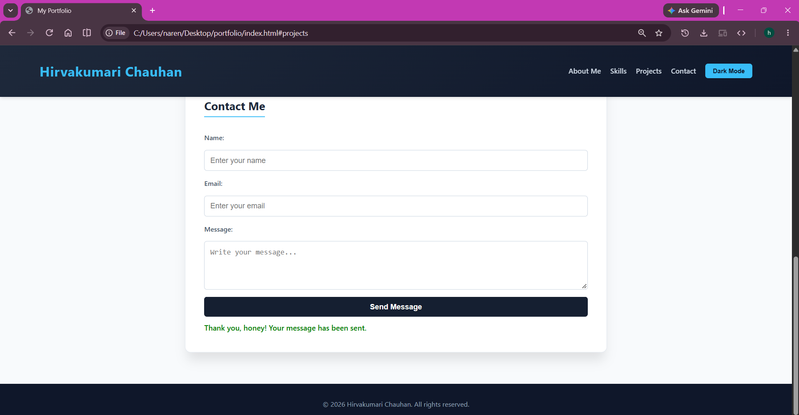

# Personal Portfolio Website

This is my personal portfolio website built for my Web Technology assessment. It showcases my introduction, technical skills, projects, and a working contact form.

## Technologies Used
* HTML5
* CSS3 (with responsive media queries)
* JavaScript (DOM manipulation & form validation)

## Portfolio Screenshots

